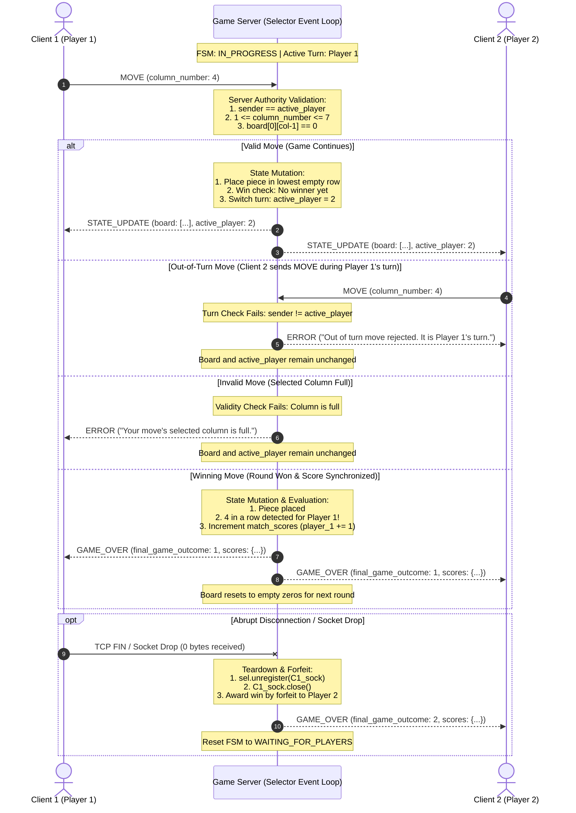

# Sprint 2: Game Behavior & Server Concurrency Architecture Design

**Project:** Connect Four Networked Game Server  
**Course:** CS 457 - Computer Networks  
**Author:** Braden Hollis  
**Target Environment:** Cisco Modeling Labs (CML) - 2 Clients, 1 Server (`server.hollis.edu`)

---

## 1. Server Concurrency Architecture & Connection Lifecycle

### 1.1 Concurrency Model Selection

- **Chosen Architecture:** Non-Blocking I/O Multiplexing (`selectors` module in Python)
- **Model Justification:**
    - Non-blocking I/O Multiplexing using `selectors / select.select` will eliminate race conditions and deadlocks because it runs sequentially on a single thread. Also, there will be less resource and context-switching overhead without having to spawn multiple OS threads. And finally, I'm familiar with multi-threading but haven't used Python's non-blocking I/O Multiplexing so it would be cool to learn more.

### 1.2 Socket Servicing & Non-Blocking Mechanics

- **Socket Configuration:**
    - Sockets are set to non-blocking mode via `sock.setblocking(False)` so system calls (`accept()`, `recv()`, `send()`) return immediately without halting the process.
- **Selector Registration:**
    - Listening socket is registered for `selectors.EVENT_READ` to detect incoming client connection attempts.
    - Connected client sockets are registered for `selectors.EVENT_READ` with an associated session object storing client metadata and a stream buffer (`bytearray`) for newline delimiter (`\n`) message extraction.

### 1.3 Complete Connection Lifecycle

Detail the 5 stages of client and socket management:

1. **Listening & Bind:**
    - The server creates a streaming socket with `server_sock = socket.socket(socket.AF_INET, socket.SOCK_STREAM)`.
    - The socket binds to `server.hollis.edu` / `192.168.20.100` on port `4570` and enters listening mode.
    - The socket is then switched to non-blocking mode and `server_sock` is registered with the selector instance. This sets up the main event loop to monitor client connection requests.
    - The server capacity is 2 active player clients. If a third player tries to connect, the connection is rejected.
2. **Client Registration & Lobbying:**
    - When the first client arrives and `server_sock` triggers an `EVENT_READ`, the server calls `server_sock.accept()`. The socket is placed in non-blocking mode and a container storing metadata (`player_id=1`) and an empty `bytearray` stream is created with `sel.register(client_sock, selectors.EVENT_READ, data=session)`.
    - Client 1 will send a `CONNECT` message to wait in the lobby. The server then transitions to `WAITING_FOR_PLAYERS`, and replies to Client 1 with `{"message_type": "LOBBY_WAIT"}\n`.
    - When Client 2 connects, its socket is also accepted and placed in non-blocking mode. It is assigned `player_id = 2` and gets its own buffer. When the server receives Client 2's `CONNECT` message, the server detects that there are two players and starts the game.
    - The server sets the 6x7 board grid to zeros, sets `active_player = 1`, transitions the FSM to `GAME_START` / `PLAYER_TURN`, and sends role assignments:
        - To Client 1: `{"message_type": "GAME_START", "player_number": 1}\n`
        - To Client 2: `{"message_type": "GAME_START", "player_number": 2}\n`
    - This is followed by broadcasting the initial `STATE_UPDATE`.
3. **Active Game Loop Servicing:**
    - The server runs a while True loop executing `events = sel.select(timeout=None)`. This keeps the process sleeping unless the OS is notified of socket activity.
    - For each (`key, mask`), if the socket is an active client socket and `mask & selectors.EVENT_READ`:
        - The server executes `chunk = sock.recv(1024)`.
        - If data is received, it's appended to the client's buffer.
    - The server scans the buffer for the newline character (`b'\n'`). While it's found at index `pos`, it slices the frame, removes the extracted frame from the buffer, decodes it as UTF-8, and parses it.
    - Lastly, the parsed dictionary is passed to `handle_move(session, payload)`. If the payload was a `MOVE`, then the server validates the move, updates the board, and sends responses.
4. **Round Completion & Score Synchronization:**
    - Following every valid move, the server evaluates the board. It looks for 4 in a row and if all of the cells are filled with no winner (draw). If either of these are detected, the server increments: `match_scores["player_1_wins"] += 1`, `match_scores["player_2_wins"] += 1`, or `match_scores["draws"] += 1`, along with incrementing `match_scores["rounds_played"]`. The server then broadcasts a `GAME_OVER` payload with the final game outcomes and scores. Lastly, the board is reset and a new game starts with the `active_player` pointing to Player 2 for round 2. All of this is done without terminating the connection.
5. **Socket Teardown & Disconnection Handling:**
    - If a TCP 0-Byte EOF is detected (aka a clean disconnect where `sock.recv()` returns `b""`), the clients gracefully disconnect.
    - If a client drops unexpectedly, the socket raises a `ConnectionResetError`, `BrokenPipeError`, or generic `OSError`. These are caught using structured `try...except` blocks enclosing all `recv()` and `send()` calls.
    - To teardown, the socket descriptor is unregistered from the selector, the socket is closed, and the disconnected client is removed from `client_sessions`. If a match was currently in session, the player who did not disconnect is the winner and the server will broadcast the final outcome and a `GAME_OVER` notification. Then the game state machine is reset to `WAITING_FOR_PLAYERS`.

---

## 2. Thread Safety & State Isolation Strategy

### 2.1 Shared State Inventory

Document all shared server resources that represent the game state:

| Shared Resource   | Data Type / Structure               | Description & Role                                                      |
| :---------------- | :---------------------------------- | :---------------------------------------------------------------------- |
| `board`           | `List[List[int]]` (6 rows x 7 cols) | Current state of the grid (0 = empty, 1 = Player 1, 2 = Player 2).      |
| `active_player`   | `int` (1 or 2)                      | Tracks whose turn it is to drop a piece.                                |
| `client_sessions` | `dict`                              | Maps player roles (1 and 2) to client sockets and receive buffers.      |
| `match_scores`    | `dict`                              | Tracks cumulative session scores (Player 1 wins, Player 2 wins, draws). |
| `game_status`     | `str`                               | Current state of the game (WAITING, IN_PROGRESS, GAME_OVER).            |

### 2.2 Event Loop State Isolation (Single-Threaded Safety)

- **Absence of Race Conditions:**
    - In a multi-threaded architecture, the OS's kernel thread scheduler can preempt. Therefore, reading `active_player`, verify valid moves, or choosing a move would be a critical section. If two clients submit moves at the same time, their execution can interleave and corrupt data without mutexes.
    - The `selectors` architecture keeps the program single threaded. The handler executes code one-at-a-time when an I/O event fires. No preemption helps the client and servers access data structures without mutexes or semaphores--running each access to completion before starting the next.
- **Atomic State Mutation:**
  Every move is atomic:
    1. _Turn Validation:_ Confirms `session.player_id == active_player`.
    2. _Boundary & Capacity Check:_ Confirms `1 <= col <= 7` and `board[0][col-1] == 0`.
    3. _Board Mutation:_ Finds lowest empty row in column `col-1` and writes the player's token.
    4. _Win/Draw Check:_ Scans the board for 4-in-a-row or a full board.
    5. _Turn Toggle / Result Resolution:_ Toggles `active_player = 2 if active_player == 1 else 1` (or triggers a game over).
    6. _Broadcast Preparation:_ Generates the `STATE_UPDATE` payload.

- **Buffer Isolation:**
    - TCP provides a stream of bytes without message boundaries, allowing fragmentation to happen between `recv()` calls. To ensure state isolation, each client is assigned a `ClientSession` object linked to its socket in the selector.
    - Each session also maintains its own `bytearray` buffer so nothing leaks between the two clients.

---

## 3. Move Validation, Turn Enforcement & State Broadcast Flow

### 3.1 Server Authority & Validation Rules

Detail the validation steps enforced by the server before any move is applied:

1. **Turn Enforcement:**
    - Verification: `sender_id == active_player`.
    - Out-of-turn rejection: Server sends `ERROR` exclusively to the sender (`"Out of turn move rejected. It is Player X's turn."`). The board and turn remain unchanged.
2. **Column Boundary Verification:**
    - Verification: `1 <= column_number <= 7`.
    - Rejection: Server returns `ERROR` if input is outside valid grid bounds.
3. **Column Capacity (Gravity) Verification:**
    - Verification: Check if the top cell of the column is empty (`board[0][col - 1] == 0`).
    - Rejection: If full, server returns `ERROR` (`"Your move's selected column is full."`).
    - Placement: If valid, chip falls to lowest empty row index in that column.

### 3.2 Synchronous State Broadcast Mechanism

- After any board change, the server creates a `STATE_UPDATE` payload:
      ```json
      {
        "message_type": "STATE_UPDATE",
        "board": [[...], [...], [...], [...], [...], [...]],
        "active_player": 2
      }
      ```

- The payload is a UTF-8 string with a `\n` delimiter before being converted into bytes. The server loops over `client_session.values()` to issue `sendall()` to both sockets back-to-back using the active move handler. Then the server returns to `sel.select` to ensure the clients can't submit a move on the stale board.
---

## 4. Score & Leaderboard Synchronization Design

### 4.1 In-Memory Score Storage

- When the server starts up, the server creates a scoreboard dict:
      ```python
      match_scores = {
          "player_1_wins": 0,
          "player_2_wins": 0,
          "draws": 0,
          "rounds_played": 0
      }
      ```

- This lives in the server's global game state and persists across rounds (even if the board is wiped).

### 4.2 Score Synchronization on Round Completion

- When 4 in a row or a full board (draw) is detected, the server increments `match_scores["rounds_played"]` by 1. If there is a winner, the corresponding player's wins are increased. If there is a draw, the match draws are incremented.
- Lastly, the server sends the game over message with a `\n` delimiter to both client sockets:
```json
{
        "message_type": "GAME_OVER",
        "final_game_outcome": 1,
        "scores": {
          "player_1_wins": 1,
          "player_2_wins": 0,
          "draws": 0,
          "rounds_played": 1
        }
      }
```
- Both clients stay connected (no TCP disconnect) while the server resets the board back to zeros. Then a fresh `STATE_UPDATE` is transmitted to both clients to start the next round.

---

## 5. Sequence Diagram: Turn Synchronization Flow

The following Mermaid sequence diagram models the client-server interaction for valid moves, out-of-turn moves, full-column moves, round victory, and disconnections:


